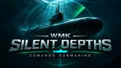

# 🌊 WMK Silent Depths — Comando Submarino



**Simulador 3D de submarinos com sonar, navegação, carta tática, academia de comando e hangar configurável.**

**Versão preparada: v0.3.0** · **Idioma: Português (Brasil)** · **Tecnologia: HTML/CSS/JavaScript e Three.js**

**Autor e personalização:** Walney Moreira Klein · **walneyk@hotmail.com**

> **Estado em 23/11/2026:** a v0.4.10 inclui minimapa flutuante, redimensionável e nomes completos dos navios. O jogo completo foi entregue como ZIP na conversa de desenvolvimento, mas **os arquivos jogáveis ainda não foram enviados para este repositório**. Para publicar o ZIP sem copiar comandos manualmente, extraia-o e execute `PUBLICAR_FORK_WINDOWS.bat` de dentro da pasta extraída (Git para Windows e autenticação GitHub necessários). O script fará clone, copiará os arquivos, criará commit e enviará ao branch `main`. **Somente após esse envio o GitHub Pages terá a versão jogável.**

> **Publicação em andamento:** os arquivos completos da v0.3.0 estão no pacote de distribuição. A versão do código no GitHub precisa receber os arquivos do ZIP antes de ser executável no Pages. A miniatura da logo acima já está hospedada neste repositório; a imagem original de alta resolução acompanha o pacote.


## 📚 Manuais e Estratégias (documentação HTML)
### 🔎 Diagnóstico de torpedos (v0.4.23)

[**Manual: corrigir e verificar lançamento de torpedos**](./manuais/estrategias/diagnostico-torpedos-v0423.html) — primeiro toque prepara o corredor, segundo tenta lançar. A versão local informa quantos objetos 3D foram realmente criados, posições, estado e motivos de bloqueio. `K` é opcional. A v0.4.23 está em um ZIP na conversa e **não está incorporada ao branch main**. O pacote inclui `PUBLICAR_FORK_WINDOWS.bat` para publicar o jogo a partir de uma máquina Windows com Git configurado.


[**Abrir os Manuais e Estratégias**](./manuais/estrategias/index.html) — guia em português de esquadrões, preparação em dois cliques, corredor de torpedos, área de queda das bombas, salvas coletivas de foguetes, HUD de assistência, trava K, radar circular e controles. Inclui diagramas SVG autorais.

**Estado da publicação em 23/11/2026:** o manual HTML está publicado neste repositório. A atualização jogável **v0.4.20** e a galeria local de capturas/conceitos estão disponíveis no pacote ZIP da conversa, mas ainda **não foram incorporadas ao branch main**. Não confunda a documentação publicada com o executável hospedado no Pages. As imagens de terceiros não foram adicionadas ao fork sem verificação de permissão.

## Recursos da v0.3.0

- Navegação 3D: potência, leme, profundidade, modo silencioso e snorkel.
- Sonar ativo e passivo, radar, periscópio e carta tática.
- Missões e academia de formação com cinco etapas.
- Torpedos, mísseis e contramedidas **simulados**.
- **Hangar de submarinos** com seleção e ficha técnica.
- **Árvore tecnológica** por níveis e desbloqueios ligados ao progresso.
- **Quatro submarinos fictícios configuráveis em JSON** com velocidade, limite de profundidade, munição, escala e cor.
- Opções gráficas **F2**, contador de FPS e preferências salvas no navegador.
- Manual interativo em português.

### Frota inicial

| Submarino fictício | Tipo | Disponibilidade |
|---|---|---|
| SSK-777 Atlântico | Diesel-elétrico | Inicial |
| SSK-208 Arraia | Diesel-elétrico | Concluir Primeira escuta |
| SSN-901 Tubarão | Ataque | Concluir Caçador silencioso |
| DSV-040 Explorador | Pesquisa | Inicial |

Os modelos atuais são procedurais. Os valores são atributos fictícios para jogabilidade e não representam especificações operacionais de embarcações reais.

## Instalação no Windows — sem Docker

1. Baixe o pacote completo do projeto.
2. Extraia o conteúdo preservando a estrutura de pastas.
3. Execute **`INICIAR_WINDOWS.bat`**. É necessário Python 3 ou PHP para servir os arquivos.
4. Acesse o endereço indicado pelo inicializador, normalmente **http://127.0.0.1:8765**.
5. Abra **Hangar e Árvore Tecnológica**, equipe um submarino e inicie uma missão.

**Importante:** os perfis de submarinos são carregados com `fetch()`; executar diretamente por `file://` pode bloquear a leitura dos JSONs. Use o servidor local.

## Controles principais

| Tecla | Função |
|---|---|
| W / S | Potência |
| A / D | Leme |
| C / X | Mergulhar / subir |
| Z | Manter profundidade |
| L / N | Silêncio / snorkel |
| R / I / T | Sonar ativo / classificar / marcar |
| J / M | Selecionar armamento |
| Espaço / Enter | Disparar armamento simulado |
| G / E | Contramedida / radar |
| 0 a 4 | Postos de comando |
| H / F2 / Esc | Manual / gráficos / pausa |

## Organização do pacote completo

```text
WMK-Silent-Depths/
├── index.html
├── style.css
├── simulator.js
├── fleet.js
├── graphics.js
├── dados/submarinos/
│   ├── catalogo.json
│   ├── wmk-atlantico.json
│   ├── wmk-arraia.json
│   ├── wmk-tubarao.json
│   └── wmk-pesquisador.json
├── vendor/three.min.js
├── logo-wmk-silent-depths.png
├── capa-facebook.jpg
├── manual.html
├── manuais/FROTA-JSON.md
├── roadmap.html
├── verify.cjs
├── INICIAR_WINDOWS.bat
└── LICENSE
```

## Testes

Para testar as regras do simulador com Node.js, execute **`node verify.cjs`**. O pacote preparado passou **57 testes automatizados**; a interface ainda exige testes visuais em diferentes navegadores e computadores.

## GitHub Pages

Depois de publicar o código e todos os arquivos na raiz do repositório, habilite **Settings → Pages → GitHub Actions**. O workflow em `.github/workflows/pages.yml` verifica se os arquivos essenciais existem antes de publicar.

## Licença MIT e créditos

**Copyright © 2026 Walney Moreira Klein**  
**E-mail:** walneyk@hotmail.com  
**GitHub:** [@WalneyNF](https://github.com/WalneyNF)

As partes de autoria própria são disponibilizadas sob a **[Licença MIT](LICENSE)**. A licença permite usar, copiar, modificar e comercializar essas partes, desde que mantenha o texto de licença e os avisos de copyright.

**Atenção:** o protótipo ABISMO e a biblioteca Three.js podem incluir direitos de terceiros. A licença adicionada aqui não altera direitos sobre código e recursos de outros titulares; devem ser preservados os avisos e verificadas as permissões aplicáveis.

## Próximas versões

- **v0.4.0:** Oficina Naval 3D, importação de modelos GLB e calibração.
- **v0.5.0:** Editor de missões e mapas.
- **v0.6.0:** Painéis móveis e postos de tripulação.
- **v0.7.0:** Danos por compartimento e reparos.

---

**WMK Silent Depths — Comando Submarino** · *Explore. Detecte. Navegue. Sobreviva.*
